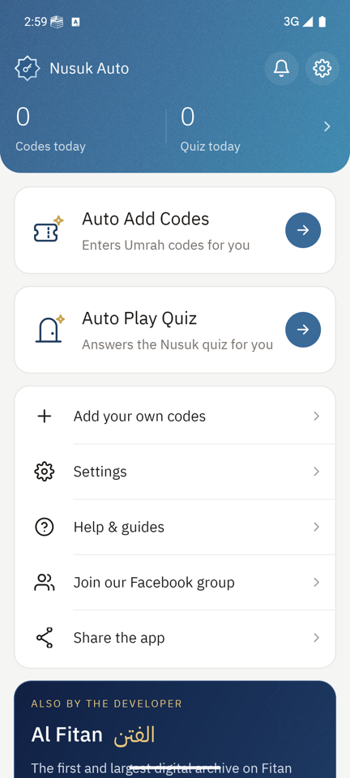
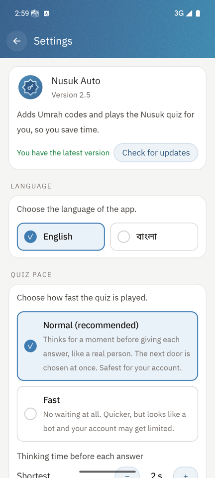
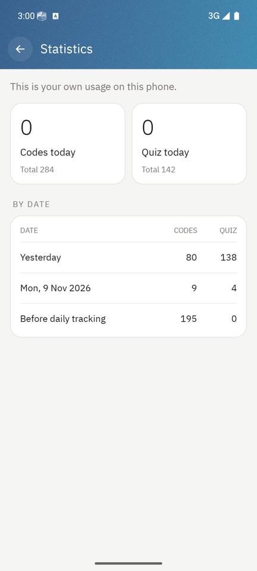
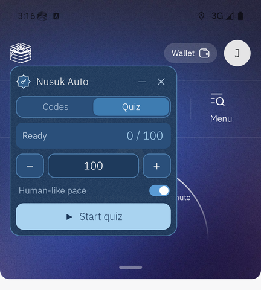
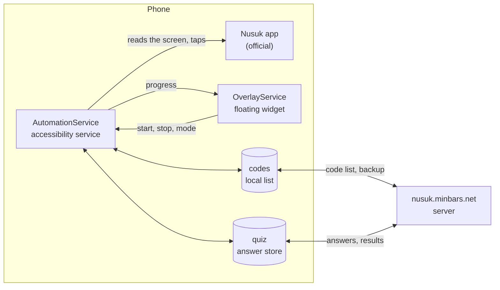

<div align="center">


# Nusuk Auto

**An Android helper that enters key codes and plays the door quiz in the Nusuk Umrah challenge, so you don't have to tap for hours.**

[](#requirements)
[](#build-from-source)
[](#build-from-source)
[](#architecture)
[](#features)

[**Download APK**](https://nusuk.minbars.net/download) &nbsp;·&nbsp; [Website](https://nusuk.minbars.net) &nbsp;·&nbsp; [Video tutorial](https://nusuk.minbars.net/tutorial) &nbsp;·&nbsp; [Help](https://nusuk.minbars.net/help) &nbsp;·&nbsp; [Facebook group](https://www.facebook.com/groups/nusukauto/)

<br>

 &nbsp;
 &nbsp;


<sub>Home &nbsp;·&nbsp; Settings &nbsp;·&nbsp; Statistics</sub>

</div>

> [!IMPORTANT]
> Nusuk Auto is an independent helper. It is not made by, or connected to, the Nusuk app or the
> Saudi Ministry of Hajj and Umrah. Use it at your own risk.

## Contents

- [What it does](#what-it-does)
- [Features](#features)
- [How it works](#how-it-works)
- [Install](#install)
- [Requirements](#requirements)
- [Permissions and privacy](#permissions-and-privacy)
- [Build from source](#build-from-source)
- [Project layout](#project-layout)
- [Architecture](#architecture)
- [How official releases are made](#how-official-releases-are-made)
- [Server](#server)
- [Contributing](#contributing)
- [Security](#security)
- [License](#license)
- [Links](#links)
- [Credits](#credits)

## What it does

The Nusuk challenge gives a key for every valid code you enter, and each key opens a door with
one quiz question. Doing that by hand means typing hundreds of codes and answering hundreds of
questions. Nusuk Auto sits on top of the official Nusuk app as a small floating widget and does
both for you.

<p align="center">
  
  <br>
  <sub>The widget over the Nusuk app: pick Codes or Quiz, set how many, press Start.</sub>
</p>

| Mode | What happens |
|---|---|
| **Codes** | Types a code into Nusuk's "Your keys" page, taps Check, reads the result, collects the key, moves to the next code. Codes that were already tried are never tried again. |
| **Quiz** | Picks a door, reads the question and every option, taps the answer, reads whether Nusuk said right or wrong, then plays again. |

## Features

- **Floating widget** over Nusuk with start, stop and live progress. It closes itself when you
  leave Nusuk.
- **Human-like pace.** Before each quiz answer the app waits a random "thinking" time (2 to 5
  seconds by default, adjustable in Settings, or Fast for no wait).
- **Answers stored on the phone.** Known questions are answered with no network call. Unknown
  ones are asked from the server, and wrong answers are reported so nobody gets them again.
- **Add your own keys.** Paste any text that has keys in it; the app finds them and adds the new
  ones to the shared list.
- **Progress backup.** Tried codes are saved to the server against an anonymous device id, so a
  reinstall does not start from zero.
- **In-app updates**, checked with SHA-256 before install.
- **English and Bangla** interface, switchable in Settings.
- **Stats** for today and all time, **announcements** from the admin, and a built-in **Help** page.
- **Small and plain.** About 600 KB, plain Java, Android SDK only, no third-party libraries, no
  analytics, no ads.

## How it works



1. You turn on the accessibility service once. It is limited to the Nusuk app's windows.
2. You open Nusuk and press Start on the widget.
3. The service reads what is on the Nusuk screen (texts and buttons, not pixels), decides which
   page it is, and performs the next tap or types the next code.
4. Results go back into the local stores and are synced with the server in the background.

## Install

1. Download the APK: <https://nusuk.minbars.net/download> (or from the [website](https://nusuk.minbars.net)).
2. Open it. If Play Protect warns about an unknown app, choose **Install anyway**.
3. Open Nusuk Auto and follow the two setup steps on the home screen: allow the floating
   overlay, then turn on Nusuk Auto in Accessibility.

Prefer to watch? The [video tutorial](https://nusuk.minbars.net/tutorial) shows every step in
English and Bangla, and the [Help page](https://nusuk.minbars.net/help) has fixes for common problems.

> [!TIP]
> On Android 13 and newer, an app installed from an APK file has its Accessibility switch greyed
> out at first. Open **Settings > Apps > Nusuk Auto > three dots (top right) > Allow restricted
> settings**, then turn on Nusuk Auto in Accessibility.

## Requirements

- Android 8.0 (API 26) or newer.
- The official Nusuk app, set to **English**. The app stops if Nusuk is in Arabic.
- Normal system font size works best. Large fonts are supported (the app scrolls to read
  everything), but are slower.

## Permissions and privacy

| Permission | Why |
|---|---|
| Accessibility service | Read the Nusuk screen and tap on it. Limited to the Nusuk app. |
| Display over other apps | The floating widget. |
| Internet, network state | Code list, quiz answers, updates, announcements. |
| Install packages | Lets the app install its own update. |
| Notifications, run at startup | Announcements, checked about every 15 minutes. |

What the app does **not** do:

- No location, contacts, phone, camera, microphone or storage access.
- No analytics or ad SDKs.
- No account, no login, no personal data. The server sees an anonymous device id (a SHA-256
  hash of `ANDROID_ID`, never the raw value), the codes this phone tried, and quiz questions.

Everything above can be checked in this source code: permissions are in `AndroidManifest.xml`,
and every network call is in `codes/`, `quiz/`, `notices/` and `update/`.

## Build from source

There is no Gradle and nothing to download besides the Android SDK. The tools are called
directly: `aapt2`, `javac`, `d8`, `zipalign`, `apksigner`.

**You need**

- JDK 17 or newer
- Android SDK platform `android-35` and build tools `35.0.0`
- `zip`

**Build a debug APK**

```bash
export ANDROID_HOME=/path/to/android-sdk        # the folder that has platforms/ and build-tools/
PLATFORM="$ANDROID_HOME/platforms/android-35/android.jar"
TOOLS="$ANDROID_HOME/build-tools/35.0.0"

mkdir -p build/gen build/classes

# 1. resources -> build/res.zip, then link them with the manifest (also writes R.java)
"$TOOLS/aapt2" compile --dir res -o build/res.zip
"$TOOLS/aapt2" link --min-sdk-version 26 --target-sdk-version 35 -I "$PLATFORM" \
    --manifest AndroidManifest.xml --java build/gen -A assets -o build/unaligned.apk build/res.zip

# 2. Java -> classes -> dex, added to the APK
javac -source 17 -target 17 -cp "$PLATFORM" -d build/classes $(find build/gen src -name "*.java")
"$TOOLS/d8" --lib "$PLATFORM" --output build $(find build/classes -name "*.class")
(cd build && zip -q unaligned.apk classes.dex)

# 3. align and sign with a key of your own
"$TOOLS/zipalign" -f -p 4 build/unaligned.apk build/aligned.apk
keytool -genkeypair -keystore debug.keystore -storepass android -keypass android -alias debug \
    -keyalg RSA -keysize 2048 -validity 10000 -dname "CN=Debug"      # first time only
"$TOOLS/apksigner" sign --ks debug.keystore --ks-pass pass:android \
    --out build/nusuk-auto-debug.apk build/aligned.apk

adb install -r build/nusuk-auto-debug.apk
```

> [!NOTE]
> A build signed with your own key cannot be installed over the official app (Android refuses a
> different signature). Uninstall the official one first, or test on another device or an emulator.
> `build/` and keystores are already in `.gitignore`.

## Project layout

```
.
├── AndroidManifest.xml        package, version, permissions, components
├── assets/
│   └── quiz_seed.json         verified quiz answers shipped with the app
├── res/                       layouts, drawables, fonts (IBM Plex, OFL), strings
├── docs/                      logo and screenshots used in this README
└── src/com/nusuk/automator/
    ├── NusukAccessibilityService.java   entry point Android binds to (name is fixed)
    ├── automation/            the engine that reads and drives the Nusuk screen
    ├── overlay/               the floating widget
    ├── codes/                 key codes: local list, download, backup, "Add keys"
    ├── quiz/                  quiz answers: local store, sync, server calls, pacing
    ├── update/                in-app update
    ├── notices/               announcements
    ├── stats/                 counters and the Stats screen
    ├── ui/                    app screens: home, settings, help, developer
    └── core/                  shared by all: device id, language, links
```

## Architecture

The code is grouped by feature, not by type. Each package holds everything one feature needs
(its data, its server calls and its screen), so a change to a feature stays in one folder.

| Package | Classes | Role |
|---|---|---|
| *(root)* | `NusukAccessibilityService` | Empty subclass of `AutomationService`. Exists only to keep the service's name. |
| `automation` | `AutomationService` | The main loop. Reads the Nusuk screen through the accessibility API and runs Codes and Quiz mode. |
| `overlay` | `OverlayService` | The floating widget: mode, start, stop, live progress. |
| `codes` | `KeyRepository`, `CodeDownloader`, `CodeSync`, `KeySubmit`, `AddKeysActivity` | Local list of codes and results, pulling the list, backing up tried codes, adding the user's own keys. |
| `quiz` | `QuizStore`, `QuizSync`, `QuizSolver`, `QuizBatch`, `QuizPace` | Answers kept on the phone (SQLite), syncing them, asking the server, reporting results in batches, the random thinking time. |
| `update` | `UpdateChecker`, `ApkInstaller`, `InstallReceiver` | Version check, download, SHA-256 check, install. |
| `notices` | `Notices`, `NoticeJob`, `NotificationsActivity` | Background check for announcements and the screen that lists them. |
| `stats` | `Stats`, `StatsActivity` | Today and all-time counters. |
| `ui` | `MainActivity`, `SettingsActivity`, `TutorialActivity`, `DeveloperActivity`, `ScreenActivity` | App screens that are not part of one feature. `ScreenActivity` is the base for the simple pages. |
| `core` | `Access`, `L`, `Links` | Anonymous device id, English to Bangla translation, outside links. |

**Dependencies.** `core` depends on nothing in the app, and every other package may use it.
Feature packages (`codes`, `quiz`, `update`, `notices`, `stats`) hold data and server calls.
`automation` uses `codes`, `quiz` and `stats` to do its work, and reports to `overlay`. `ui` sits
on top and may use everything. A class is `public` only when another package needs it.

**Names Android remembers.** Two component names are stored on users' phones and must not change:

- `com.nusuk.automator.NusukAccessibilityService`: Android keeps "switched on in Accessibility"
  under this name. Renaming it would switch the service off for every user at the next update.
  That is why the root class exists and the real code lives in `automation.AutomationService`.
- `com.nusuk.automator.MainActivity`: the launcher entry. It is an `<activity-alias>` in the
  manifest that points to `ui.MainActivity`, so existing home screen icons keep working.

## How official releases are made

The release scripts and the signing key are kept outside this repository. This is what they do.

**Build.** The same steps as [Build from source](#build-from-source), signed with the release key:

1. `aapt2` compiles `res/`, links it with `AndroidManifest.xml` and generates `R.java`
   (min SDK 26, target SDK 35).
2. `javac` (Java 17) compiles `src/` and `R.java` against `android.jar`.
3. `d8` turns the classes into `classes.dex`, which is added to the APK.
4. `zipalign`, then `apksigner` signs the APK with the release key.
5. The certificate fingerprint is checked. A build signed with any other key is rejected.

The app has no third-party libraries, so there is nothing else to download or link.

**Signing key.** Every release is signed with the same key. Android refuses an update signed
with a different one, and users would have to uninstall and lose their saved progress. The key
and its password are kept offline and are not in any repository.

**Release.**

1. `android:versionCode` (plus 1) and `android:versionName` are raised in `AndroidManifest.xml`.
2. The APK is built and its SHA-256 is calculated.
3. The APK is uploaded to file storage twice: under a fixed name (what the website's download
   link serves) and under a name with its version code (kept for rollback).
4. `version.json` is uploaded last, so the app never announces a file that is not there yet:
   `{"versionCode", "versionName", "minVersionCode", "url", "notes", "sha256"}`.
5. Phones read `version.json` (`UpdateChecker.java`), offer the update, download the APK, check
   its SHA-256 and hand it to Android's installer (`ApkInstaller.java`). A phone below
   `minVersionCode` gets an update dialog it cannot dismiss.

## Server

The app talks to the web app at `nusuk.minbars.net` (a Cloudflare Worker, kept in a separate
repository) for the code list, quiz answers, progress backup and announcements. Update files
are served from `files-nusuk.minbars.net`. Every request carries the anonymous device id in an
`X-Device-Id` header; there are no API keys or tokens in the app.

## Contributing

Bug reports and fixes are welcome.

- **Found a bug?** Open an issue with your phone model, Android version, the app version (shown
  in Settings) and what was on the Nusuk screen. Settings has a **debug report** you can share.
- **Nusuk changed a screen?** That is the most common breakage. The page detection and button
  texts are in `automation/AutomationService.java`.
- **Sending a pull request?** Keep it to one change. The code is plain Java with the Android SDK
  only: please do not add libraries or a build system. Put new classes in the package of the
  feature they belong to, and keep classes and members non-public unless another package needs
  them. Make sure the [build](#build-from-source) passes.
- **New texts** in the app are written in English in the code, with the Bangla version added in
  `core/L.java`.

Questions and ideas are easier in the [Facebook group](https://www.facebook.com/groups/nusukauto/).

## Security

If you find a security or privacy problem, please do not open a public issue. Contact the
developer privately through <https://jafran.dev> first, so it can be fixed before it is public.

The release signing key and its password are never stored in this or any other repository.

## License

The source is public so that anyone can read and check what the app does. No license has been
chosen yet, which means all rights are reserved for now. You are welcome to read the code and
to build it in order to check it or to contribute a fix. Please ask before you redistribute it
or publish an app based on it.

The bundled IBM Plex fonts are under the SIL Open Font License (`assets/OFL-IBM-Plex.txt`).

## Links

| | |
|---|---|
| Download (latest APK) | <https://nusuk.minbars.net/download> |
| Website | <https://nusuk.minbars.net> |
| Video tutorial | <https://nusuk.minbars.net/tutorial> |
| Help and fixes | <https://nusuk.minbars.net/help> |
| Community (Facebook group) | <https://www.facebook.com/groups/nusukauto/> |
| Source code | <https://github.com/jafranonline/nusuk-auto> |

The APK on the website is the only official build. Nusuk Auto is not on Google Play.

## Credits

<table>
  <tr>
    <td width="96"></td>
    <td>
      <b>Jafran Hasan</b><br>
      Design, development and maintenance.<br>
      <a href="https://jafran.dev">jafran.dev</a> &nbsp;·&nbsp;
      <a href="https://github.com/jafranonline">GitHub</a> &nbsp;·&nbsp;
      <a href="https://www.facebook.com/jafranonline/">Facebook</a>
    </td>
  </tr>
</table>

**Thanks to**

- **The Nusuk Auto community.** Members of the [Facebook group](https://www.facebook.com/groups/nusukauto/)
  share key codes, test every release on their own phones and report what breaks.
- **IBM Plex** by IBM, the typeface used across the app, under the
  [SIL Open Font License 1.1](assets/OFL-IBM-Plex.txt).
- **Android Open Source Project.** The app is built with the Android SDK and its build tools only.
- **Cloudflare Workers, D1 and R2**, which host the server, its database and the app downloads.

**Also by the developer:** [Al Fitan](https://alfitan.com/), a digital archive on the trials and
signs of the Hour.

**Trademarks.** "Nusuk" and the Nusuk logo belong to their owner. They are used here only to say
which app this helper works with. Nusuk Auto is not affiliated with, endorsed by or sponsored by
Nusuk or the Saudi Ministry of Hajj and Umrah.

---

<div align="center">

Made by [Jafran Hasan](https://jafran.dev) &nbsp;·&nbsp; [nusuk.minbars.net](https://nusuk.minbars.net)

</div>
